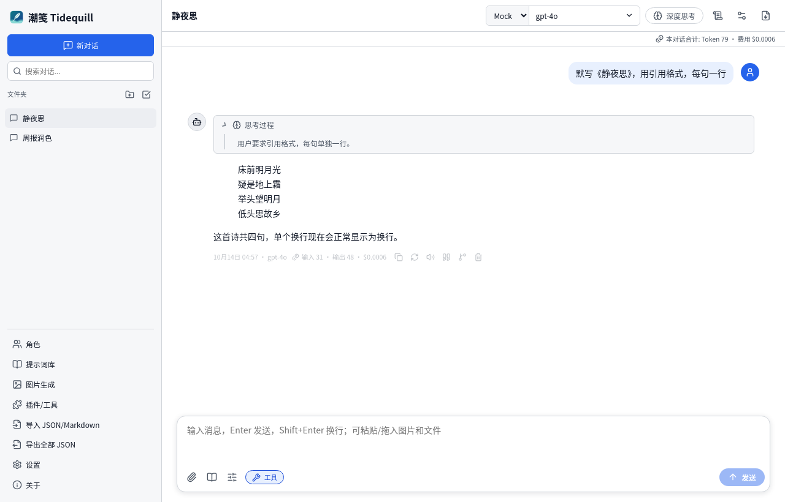
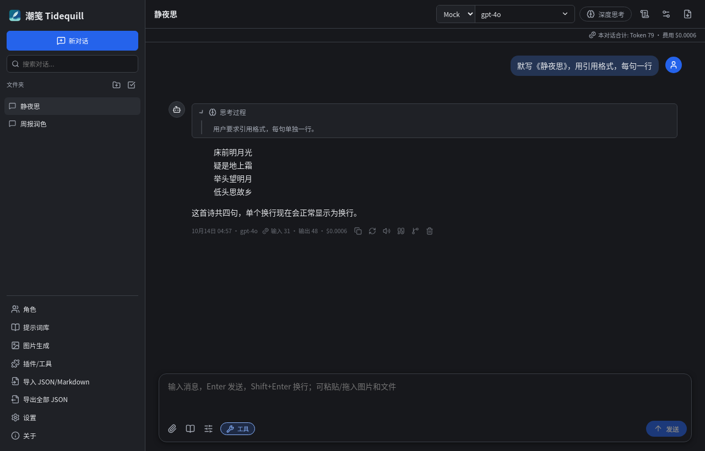
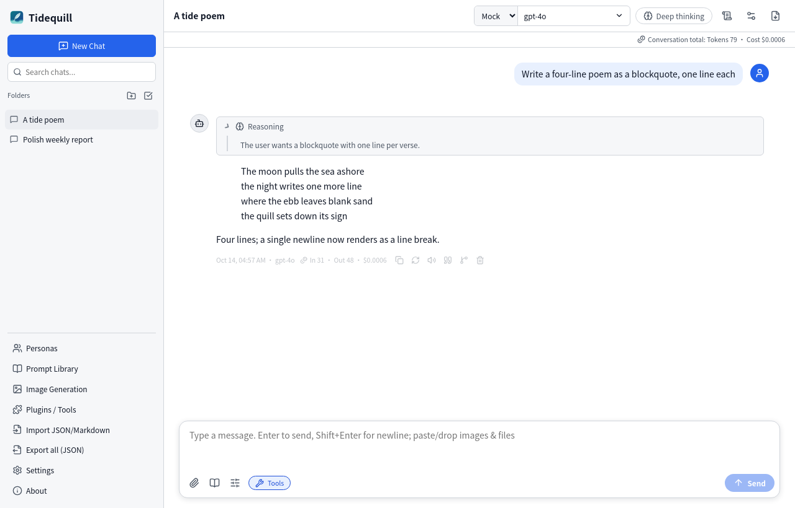
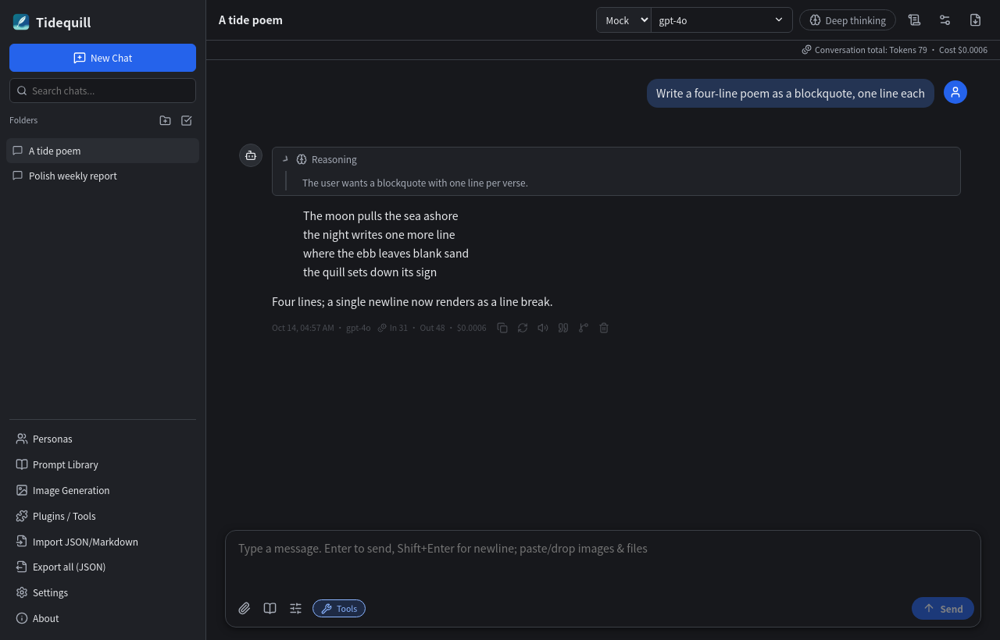

<p align="center"></p>

# Tidequill (潮笺)

[简体中文](README.md) | English · [Changelog](CHANGELOG.md)

## Introduction

**Tidequill** is an independent, MIT-licensed, cross-platform desktop AI chat client built with **Electron + React + TypeScript + Vite**. The UI language follows the system: Simplified Chinese on Chinese systems, English elsewhere. You can switch it in Settings → General.

| Light · 中文 | Dark · 中文 |
|---|---|
|  |  |
| **Light · English** | **Dark · English** |
|  |  |

## Features

- **Providers**: OpenAI and any OpenAI-compatible API (DeepSeek, xAI Grok and Qwen are preset), Anthropic Claude, Google Gemini, and Ollama (local, auto-detected). You can fetch model lists with one click and pick a provider and model per conversation.
- **Chat**:
  - Streaming and stop.
  - Regenerate and edit & resend; old versions are kept as branches.
  - Fork to a new conversation, quote reply, delete a single message, read aloud.
  - Auto title: after the first reply, a short title is summarized. You can turn this off, and a manual rename is never overwritten.
- **Deep thinking**: sends the parameters documented by each provider (see the table below). The reasoning appears in a collapsible block.
- **Rendering**:
  - Markdown (GFM), where a single newline is a line break.
  - Code highlighting with copy, line numbers and folding.
  - KaTeX math, and Mermaid diagrams with zoom, copy source and SVG download.
- **Organization**:
  - Folders, tags, pinning and renaming.
  - Full-text search with snippets and batch delete.
  - Per-conversation system prompt and sampling parameters.
- **Usage & cost**: token counts and estimated cost for each message and each conversation. The price table is editable. Models with no price show "No price set", and clicking it takes you to the price table to add one.
- **Request transparency**: Conversation settings → "View request content" shows the system prompt, tool definitions and messages (bytes plus a token estimate) and the full JSON body of the last request. The API key is never shown. By default no system prompt and no tool definitions are sent.
- **Attachments & images**:
  - PDF, DOCX, TXT/MD/CSV/JSON and code files; their text is extracted into the context.
  - Images go to vision models.
  - Image generation uses the OpenAI Images API.
  - Excel and PPT files are **not** supported, and there is **no** built-in web search. You can add web search through MCP or a plugin.
- **Plugins / MCP**: MCP servers over stdio or HTTP (Streamable HTTP with SSE fallback), plus a simple CommonJS plugin API. Every tool call asks you to confirm.
- **Data**:
  - Local JSON storage, with API keys encrypted by safeStorage.
  - Backup and restore.
  - Markdown, JSON and PDF export.
  - Optional WebDAV sync.
- **System**: global shortcut `Ctrl+Shift+Space`, tray, launch at login, and update checks via GitHub Releases.

## Installation

Download the Windows installer (`Tidequill-Setup-<version>-x64.exe`) or the portable build (`Tidequill-<version>-portable.exe`) from [Releases](https://github.com/KirinWhip/tidequill/releases/latest), plus `SHA256SUMS.txt`.

- **Unsigned build**: a code-signing certificate costs money every year, so the exe is unsigned and Windows SmartScreen shows "Windows protected your PC". Click **More info → Run anyway**.
- **Installer**: you can install for all users or only for yourself, and choose the folder. To uninstall, go to Settings → Apps → Tidequill. Your data stays in `%APPDATA%\Tidequill`.
- **Portable**: runs from any folder. It starts a little slower because it unpacks to a temp folder, and it does not auto-update.
- **Verify SHA256** in PowerShell:
  ```powershell
  Get-Content .\SHA256SUMS.txt | ForEach-Object {
    $h, $f = $_ -split '\s+\*?', 2
    if (Test-Path $f) { '{0}  {1}' -f $f, ((Get-FileHash $f -Algorithm SHA256).Hash -eq $h.ToUpper()) }
  }
  ```

## Usage

1. On first launch, pick a provider, enter your API key, then click **Test connection** and **Get started**.
2. Choose the provider and model at the top. **Deep thinking** turns reasoning on. The gear icon opens conversation settings: parameters, folder, tags and the request view.
3. Shortcuts: `Ctrl+N` new chat, `Ctrl+K` search, `Ctrl+,` settings, `Esc` close.

### Why are input tokens higher than my message?
A request can also carry:
- a system prompt (none by default);
- tool definitions (not sent by default; sent only when plugins or MCP are enabled, and each tool costs tokens);
- history messages within the context length;
- the provider's own message framing.

Use **View request content** to see exactly what was sent.

### Deep thinking parameters
| Provider | On | Off | Reasoning field | Docs |
|---|---|---|---|---|
| DeepSeek (api.deepseek.com) | `thinking: {type: "enabled"}`, `reasoning_effort: "high"` | `thinking: {type: "disabled"}` (thinking is on by default upstream) | `reasoning_content` | [Thinking Mode](https://api-docs.deepseek.com/guides/thinking_mode) |
| OpenAI o-series / gpt-5 | `reasoning_effort: "high"` | not sent | not shown (Chat Completions; Responses API reasoning summaries not implemented) | [Reasoning](https://developers.openai.com/api/docs/guides/reasoning) |
| Claude 4.6+ / 5.x | `thinking: {type: "adaptive", display: "summarized"}` | not sent | `thinking_delta` | [Thinking](https://platform.claude.com/docs/en/build-with-claude/thinking) |
| Claude ≤ 4.5 | `thinking: {type: "enabled", budget_tokens}` (≥1024, < max_tokens) | not sent | `thinking_delta` | [Extended thinking](https://docs.anthropic.com/en/docs/build-with-claude/extended-thinking) |
| Gemini 3 | `thinkingConfig: {includeThoughts: true, thinkingLevel: "high"}` | not sent | parts with `thought: true` | [Gemini thinking](https://ai.google.dev/gemini-api/docs/thinking) |
| Gemini 2.5 | `thinkingConfig: {includeThoughts: true, thinkingBudget: -1}` | not sent | same | same |
| Ollama (/v1) | `reasoning_effort: "high"` | `reasoning_effort: "none"` | `reasoning` | [OpenAI compatibility](https://github.com/ollama/ollama/blob/main/docs/api/openai-compatibility.mdx) |

### Plugins
Drop a CommonJS `.js` file into Plugins/Tools → Open plugin folder. It should export `{ name, description, tools: [{ name, description, parameters, execute }] }`.

The builtin demo tools `get_current_time` and `calculator` are not sent unless you enable them in Settings → Chat. Plugins run in the main process with full local permissions, so only install plugins you trust.

## Development

You need Node.js 20 or later.

```bash
npm install
npm run dev                 # Vite + Electron with hot reload
npm test                    # unit tests (vitest)
npm run build               # type-check + build renderer/main + third-party notices
npm run pack:linux-dir && ./scripts/e2e-linux.sh   # Linux E2E (Xvfb + gnome-keyring)
npm run dist:win && npx playwright test            # Windows package + E2E
```

CI (`.github/workflows/ci.yml`) runs on `windows-latest`: unit tests, packaging, E2E against the packaged exe, then uploads the Playwright HTML report and screenshots. Pushing a `v*` tag creates a Release that includes `SHA256SUMS.txt`.

## License

MIT (see `LICENSE`). Tidequill is an independent implementation and reuses no code or assets from GPL projects such as chatboxai/chatbox. See [`docs/LICENSE-AUDIT.md`](docs/LICENSE-AUDIT.md). Third-party components are listed in [`THIRD_PARTY_NOTICES.txt`](THIRD_PARTY_NOTICES.txt) and on the in-app About page.
