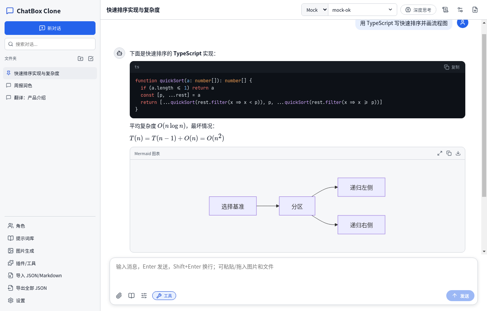
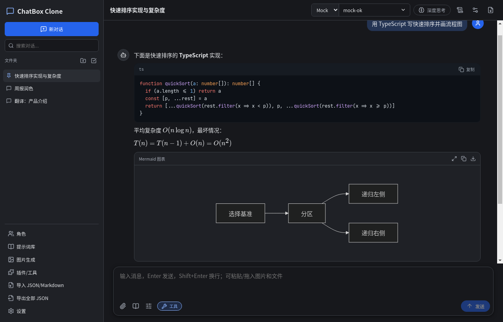
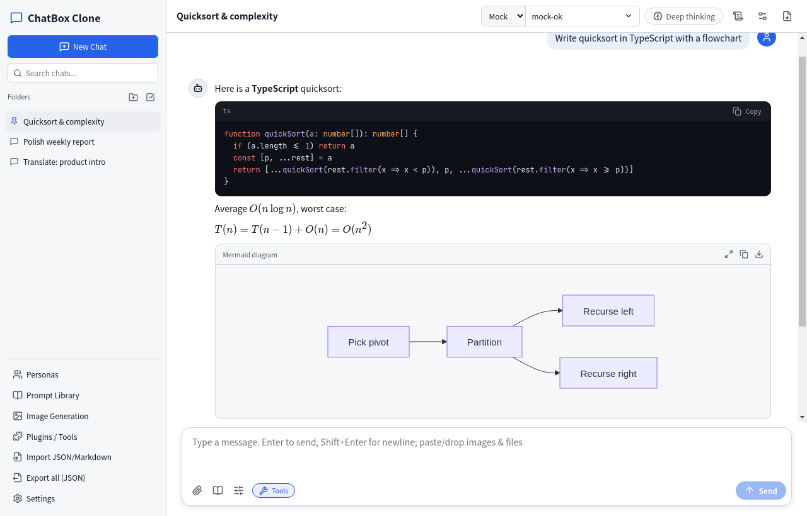
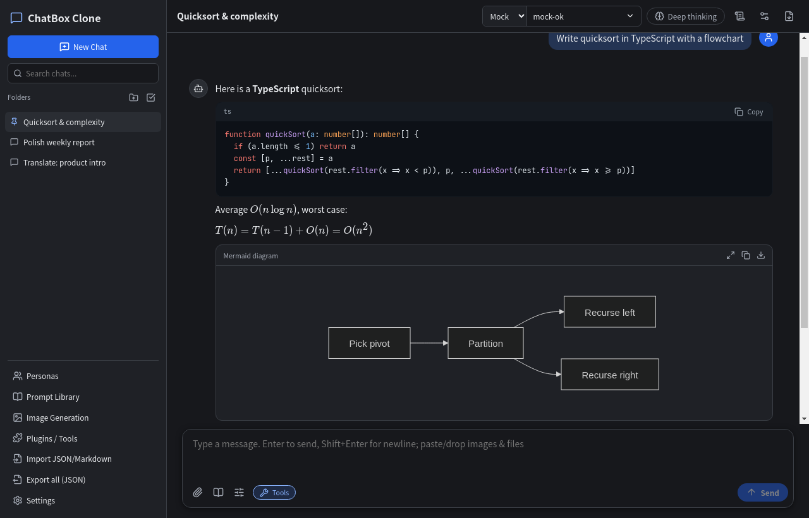

# ChatBox Clone — 桌面 AI 聊天客户端

一个类似 [Chatbox AI](https://chatboxai.app) 的跨平台桌面 AI 聊天客户端，基于 **Electron + React + TypeScript + Vite**。界面语言默认跟随系统（中文系统显示简体中文，其他显示 English），可在 设置 → 通用 中手动切换。

| 浅色 · 中文 | 深色 · 中文 |
|---|---|
|  |  |
| **浅色 · English** | **深色 · English** |
|  |  |

## 功能

- **多模型提供方**：OpenAI 及任意 OpenAI 兼容接口（DeepSeek、xAI Grok、通义千问等，已预置）、Anthropic Claude、Google Gemini、Ollama（本地）。在设置中填写 API 密钥 / API 地址，可一键「获取模型」列表；每个对话可单独选择提供方与模型。
- **对话**：流式输出、停止生成、重新生成、编辑后重发、复制、删除单条消息。
- **渲染**：Markdown（GFM 表格等）、代码高亮（含一键复制）、LaTeX 公式（KaTeX，支持 `$…$`、`$$…$$`、`\(…\)`、`\[…\]`）、Mermaid 流程图。
- **多会话管理**：侧边栏、搜索（标题与内容）、重命名、删除、置顶；本地持久化；导出单个对话为 Markdown，导出全部为 JSON，导入 JSON / Markdown。
- **系统提示词 / 角色（Persona）**：每个对话可编辑系统提示词（顶部 🧠 按钮）；角色库可新建/编辑并一键以该角色开启新对话。
- **提示词库**：可增删改，输入框旁 📚 按钮快速插入。
- **图片输入**：粘贴、拖拽或上传图片，发送给视觉模型（OpenAI/Claude/Gemini/Ollama 格式均已适配）。
- **图片生成**：调用 OpenAI Images API（dall-e-3、gpt-image-1 等，也可用于兼容接口），生成结果保存到图库，可放大查看、下载、删除。
- **文件附件**：PDF（pdf.js）、DOCX（mammoth）、TXT/MD/CSV/JSON 及各类代码文件，提取文本后放入上下文。
- **插件 / 工具**：
  - **MCP 服务器**：支持 stdio 与 HTTP（Streamable HTTP，自动回退 SSE），其工具以 function calling 方式提供给模型（OpenAI 兼容、Claude、Gemini 均支持），自动多轮调用（最多 8 轮），工具调用过程可展开查看。
  - **简易插件 API**：在插件目录（插件/工具 → 打开插件目录）放入 CommonJS `.js` 文件即可：
    ```js
    module.exports = {
      name: 'weather',
      description: '查询天气',
      tools: [{
        name: 'get_weather',
        description: 'Get weather of a city',
        parameters: { type: 'object', properties: { city: { type: 'string' } }, required: ['city'] },
        execute: async ({ city }) => `${city}：晴，25°C`,
      }],
    }
    ```
    内置插件：`get_current_time`、`calculator`。
- **设置**：温度、最大输出 Token、上下文消息数、请求超时、浅色/深色/跟随系统主题、字号、HTTP/SOCKS 代理、发送键（Enter 或 Ctrl+Enter）。
- **快捷键**：`Ctrl+N` 新建对话，`Ctrl+K` 搜索，`Ctrl+,` 设置，`Esc` 关闭弹窗，`F12` 开发者工具。

数据保存在 `%APPDATA%\ChatBox Clone\data\*.json`（Windows），插件在 `%APPDATA%\ChatBox Clone\plugins`。

## v0.4.0 新增（P2）

- **对话级设置**：每个对话可单独设置系统提示词、温度、Top P、最大输出 Token、上下文消息数（标题栏齿轮按钮或右键菜单 → 对话设置；留空即使用全局默认）。
- **对话操作**：编辑后重发与重新生成都会保留旧版本为“分支”，消息下方用 ‹ 1/2 › 切换；“从此处分支到新对话”；停止生成；删除单条消息；引用回复（发送时以 `> ` 引用块附在消息前）。
- **网络**：自定义 API 地址、HTTP / SOCKS 代理、请求超时、失败自动重试（次数和初始间隔可配置，指数退避 + 抖动，仅在尚未输出任何内容时重试）。错误提示细分为：密钥无效、余额/额度不足、频率限制、超时、网络不可达、模型不存在、上下文过长、服务器错误等，并解析 OpenAI / Anthropic / Gemini / DeepSeek / 通义 等的错误体。
- **用量与费用**：每条回复显示输入/输出 Token 与估算费用，标题栏下显示本对话合计；提供方不返回用量时按字符估算并标注“估算”。价格表可编辑（模型名包含匹配或 `/正则/`），可在设置中关闭显示。
- **会话管理**：文件夹（新建、重命名、折叠、删除）、标签与标签筛选、置顶、重命名、右键菜单（移动到文件夹、编辑标签、导出、删除）、全局搜索含消息内容并显示命中片段、多选批量删除。
- **Ollama**：设置 → 提供方 → “检测本地 Ollama”，读取 `localhost:11434/api/tags` 列出已安装模型。
- **数据**：完整备份 / 恢复（默认不含 API 密钥，可勾选包含）；单个对话导出 Markdown / JSON / PDF（Electron printToPDF）；可选 WebDAV 同步（合并策略：按更新时间取新，删除通过墓碑记录同步；WebDAV 密码与 API 密钥一样用系统加密存储）。
- **系统**：全局显示/隐藏快捷键（默认 `Ctrl+Shift+Space`）、系统托盘（关闭窗口时驻留托盘）、开机启动（仅 Windows / macOS）、基于 GitHub Releases 的更新检查（electron-updater），设置中有完整快捷键列表。
- **首次启动引导**：选择提供方、填写密钥、“测试连接”（拉取模型列表验证）。

## 界面（v0.3.0）

- 全部图标使用 Lucide（导入/导出使用不同图标）；设计令牌（颜色、圆角、间距、字号）统一定义在 `src/renderer/theme/tokens.ts`，浅色/深色/跟随系统，所有文字配色对通过 WCAG AA（`tests/contrast.test.ts` 自动检查）。
- 顶部模型选择：提供方下拉 + 可搜索的模型下拉框，自动拉取 `/v1/models`（或各厂商等价接口）并缓存 24 小时，可直接输入自定义模型名。
- “深度思考”开关：OpenAI 兼容接口发送 `reasoning_effort=high`，Claude 启用 extended thinking，Gemini 启用 thinking；返回的思考过程（`reasoning_content` / thinking / thought）以可折叠块显示。
- 输入区：输入框下方工具栏（附件、提示词库、模型参数弹层、工具开关），右侧发送按钮生成中变为“停止”；图片附件显示缩略图、文件显示标签，均可移除。
- 消息：图标头像；悬停显示时间、模型名以及复制/编辑/重新生成/朗读（speechSynthesis）/删除。
- 代码块：语言标签、复制按钮（“已复制”反馈）、可选行号、长代码折叠；表格带边框和斑马纹；Mermaid 带内边距、放大查看、复制源码、下载 SVG。

## 安全设计

- 渲染进程：`contextIsolation: true`、`nodeIntegration: false`、`sandbox: true`、`webSecurity: true`；拒绝所有权限请求；禁止页面跳转到外部地址。
- **所有模型 API 请求经主进程转发**（IPC 流式回传，`electron/http.ts`），渲染进程 CSP 为 `connect-src 'self'`，无法直接访问网络。
- 生产构建注入严格 CSP（`script-src 'self'`，见 `vite.config.ts`）。
- API 密钥用 Electron `safeStorage` 加密存储（Windows DPAPI / macOS 钥匙串 / Linux libsecret），旧版明文密钥在首次读取时自动迁移为密文。Linux 上若没有 keyring 服务则无法加密，设置页会显示警告。
- Markdown 不渲染原始 HTML，链接只允许 http(s)/mailto；Mermaid 使用 `securityLevel: 'strict'`，输出的 SVG 再经 DOMPurify 清洗。
- MCP / 插件工具调用前弹出原生确认框，显示工具名和 JSON 参数，可“允许 / 拒绝”，可勾选“始终允许此工具”（可在 插件/工具 页撤销）。
- 注意：插件运行在主进程中，拥有完整本机权限，请只安装可信插件。

## 开发运行

需要 Node.js 20+。

```bash
npm install
npm run dev        # 启动 Vite 开发服务器 + Electron（热更新）
```

其他命令：

```bash
npm test           # 单元测试（vitest）：提供方适配器、存储、密钥加密、i18n 硬编码检查、主进程 HTTP 桥 + 模拟服务器、插件/MCP
node tests/mock-server.mjs 18080   # 启动模拟 OpenAI 兼容服务器（模型名 mock-ok / mock-401 / mock-429 / mock-timeout / mock-disconnect / mock-tool）
npm run build      # 类型检查 + 打包渲染进程(dist/) + 主进程(dist-electron/)
npm start          # 运行已构建版本
```

## 端到端测试（Playwright）

E2E 测试直接驱动**打包后的应用**（`release/*-unpacked`）：

```bash
npm run pack:linux-dir && ./scripts/e2e-linux.sh   # Linux（Xvfb + gnome-keyring）
npm run dist:win && npx playwright test            # Windows
```

覆盖：停止生成、模型搜索与自定义模型、深度思考、消息悬停操作、代码复制反馈/行号/折叠、表格斑马纹、Mermaid 工具栏、附件标签移除；启动与安全配置、明文密钥迁移、新建对话 + 流式回复、401 / 429 / 超时 / 中途断开 / 网络不可达的本地化错误提示、主题与语言切换（含重启后保持）、JSON/Markdown 导出与导入、工具调用确认（拒绝 / 始终允许）、四种主题×语言截图。报告输出到 `playwright-report/index.html`，截图在 `screenshots/p1/`。

## 持续集成

`.github/workflows/ci.yml`：在 `windows-latest` 上执行单元测试 → 构建 NSIS 安装包和便携版 → 对打包后的 exe 运行 Playwright E2E → 上传报告、截图和安装包；推送 `v*` 标签时自动创建 GitHub Release 并附带安装包。

## 打包

```bash
npm run dist:win     # Windows：NSIS 安装包 + 便携版 exe，输出到 release/
npm run dist:linux   # Linux AppImage
```

在 Windows 上直接运行 `npm run dist:win` 即可。在 Linux 上交叉打包 Windows 需要安装 wine（`sudo apt install wine`）。

产物（release/ 目录）：
- `ChatBox Clone-Setup-0.3.0-x64.exe` — 安装程序（可选择安装目录，中文界面）
- `ChatBox Clone-0.3.0-portable.exe` — 便携版，免安装

> 安装包未签名，首次运行时 Windows SmartScreen 可能提示「未知发布者」，点「更多信息 → 仍要运行」即可。

## 项目结构

```
electron/main.ts      主进程：窗口、存储（密钥加密）、代理、文件对话框、HTTP 桥、工具确认
electron/http.ts      主进程 HTTP 桥（超时/断线/网络错误分类）
electron/secrets.ts   safeStorage 加密与迁移
electron/tools.ts     MCP 客户端（stdio/HTTP）与插件加载器
electron/preload.ts   安全桥接 API (window.api)
src/shared/           与界面无关的逻辑：提供方适配器（请求构造/流式解析）、存储、导入导出
src/renderer/         React 界面：App、Markdown 渲染、设置/角色/提示词/图片/插件面板、i18n
tests/                单元测试与模拟服务器
e2e/                  Playwright E2E
src/renderer/locales/ 语言包（zh-CN、en）
```

## 说明 / 已知限制

- 详见 `docs/self-audit.md`（功能自查与已知问题）。
- 安装包未签名（已有应用图标与托盘图标）。
- 自动更新：仓库目前为私有，GitHub Releases 对未登录客户端不可见，因此真实环境中“检查更新”会失败，需将仓库或发布页设为公开后才可用；E2E 只用本地模拟的更新源验证了“发现新版本”，未验证下载与安装。
- 开机启动在 Linux 上不支持；Windows 上仅调用了 Electron 的 `setLoginItemSettings`，未在真实重启中验证。
- DeepSeek reasoner 等模型的“思考过程”字段暂不显示。
