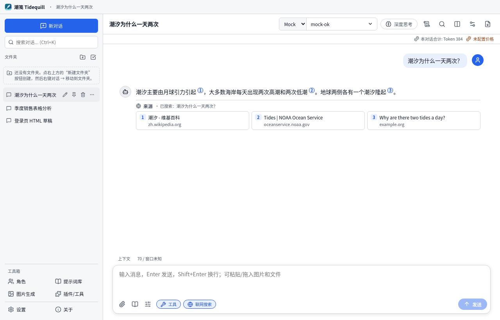
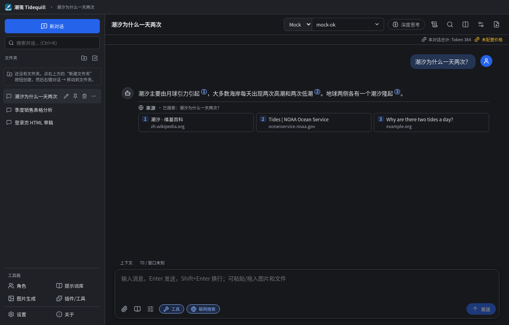
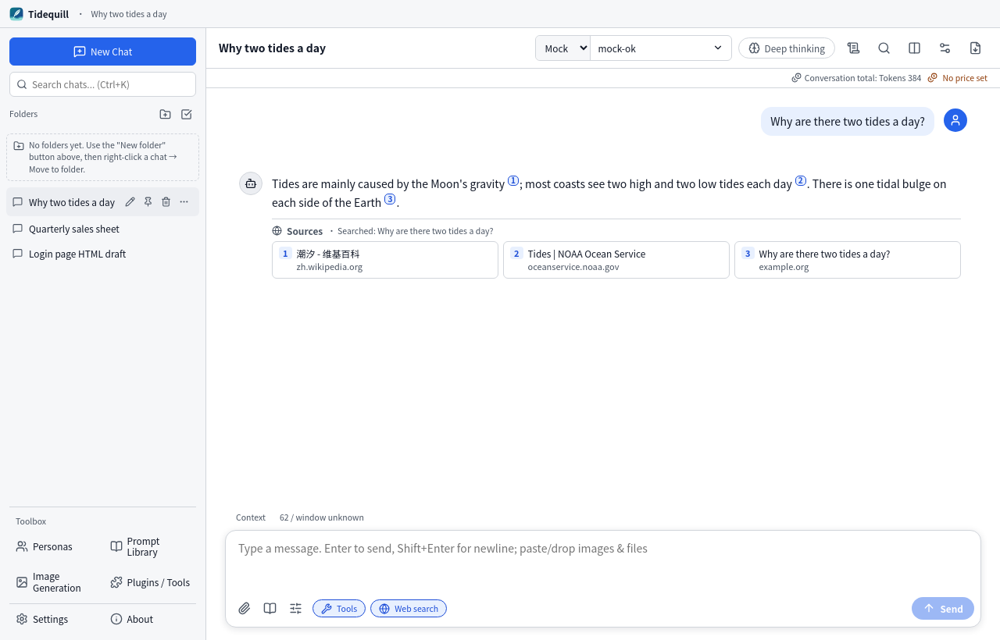
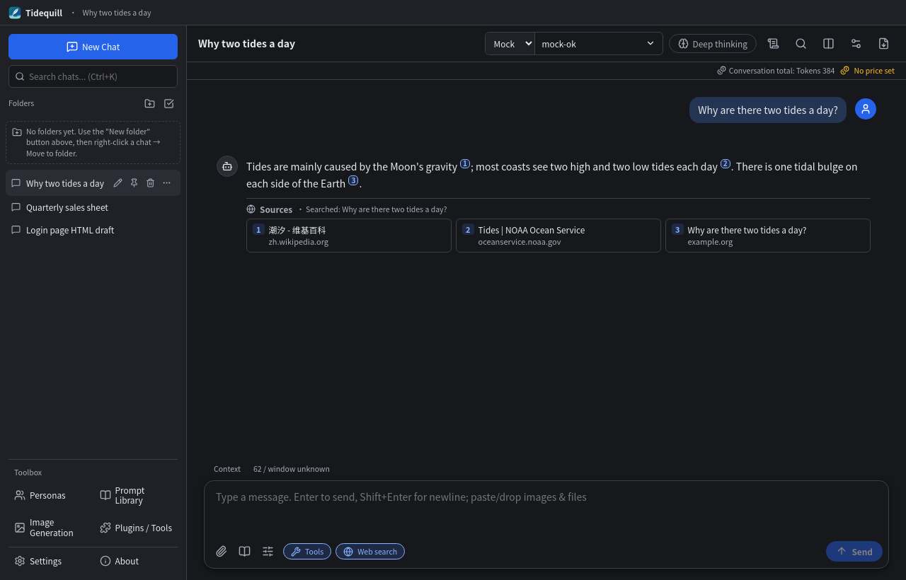

<p align="center"></p>

# 潮笺 Tidequill

简体中文 | [English](README.en.md) · [更新日志](CHANGELOG.md)

## 简介

**潮笺（Tidequill）** 是一个独立开发、以 MIT 许可开源的跨平台桌面 AI 聊天客户端，基于 **Electron + React + TypeScript + Vite**。界面语言默认跟随系统（中文系统显示简体中文，其他系统显示 English），也可以在 设置 → 通用 中手动切换。

| 浅色 · 中文 | 深色 · 中文 |
|---|---|
|  |  |
| **浅色 · English** | **深色 · English** |
|  |  |

## 功能

- **多模型提供方**：OpenAI 及任意 OpenAI 兼容接口（DeepSeek、xAI Grok、通义千问等已预置）、Anthropic Claude、Google Gemini、Ollama（本地，可自动检测）。可以一键获取模型列表，每个对话单独选择提供方和模型。
- **对话**：
  - 流式输出、停止生成、重新生成、编辑后重发（旧版本保留为分支，可切换）、分支到新对话。
  - 引用回复、删除单条消息、朗读。
  - 首次回复后自动总结一个不超过 10 个字的标题（可关闭，手动改名后不会覆盖）。
- **深度思考**：按各家官方文档发送参数（详见下方“深度思考参数”），思考过程以可折叠块显示。
- **渲染**：
  - Markdown（GFM），单个换行即显示为换行。
  - 代码高亮，支持复制、行号和折叠。
  - KaTeX 公式；Mermaid 图表，可放大、复制源码、下载 SVG。
- **会话管理**：
  - 文件夹、标签、置顶、重命名、右键菜单。
  - 全文搜索（显示命中片段）、多选批量删除。
  - 每个对话可单独设置系统提示词、温度、Top P、最大输出 Token、上下文消息数。
- **用量与费用**：每条消息和整个对话的 Token 合计及估算费用，价格表可编辑。没有价格的模型显示“未配置价格”，点击可直接添加。
- **请求透明**：对话设置 → “查看本次请求内容”，显示最近一次请求实际发送的系统提示词、工具定义、消息（大小和 token 估算）以及完整 JSON（密钥不显示）。默认不附带任何系统提示词，也不附带工具定义。
- **附件与图片**：
  - 支持 PDF、DOCX、**XLSX、PPTX**、TXT/MD/CSV/JSON 和各类代码文件（提取文本放入上下文）。XLSX 输出每个工作表的单元格值（公式不重新计算，使用文件里保存的结果）；PPTX 输出每页文字和演讲者备注。旧版 .xls / .ppt / .doc 不支持。
  - 文件超过上限（默认 20 MB，可在 设置 → 对话 中修改）时会直接提示文件大小和上限，不会静默失败。
  - 图片可以粘贴、拖拽或上传，发送给视觉模型。可选的本地文字识别（OCR，tesseract.js，默认关闭，语言数据按需下载）。
  - 图片生成使用 OpenAI Images API。
- **联网搜索**：Tavily、SearXNG（自建）、Brave Search，以及 Bing Web Search 兼容接口（微软已于 2025-08-11 停止官方 Bing Search API）。输入框工具栏一键开关；回复中的 [1] 等编号和下方“来源”都链接到原网页。搜索密钥用系统加密保存，请求由主进程发出。
- **代码预览**：回复中的 HTML / SVG 代码块可以在沙箱中预览（独立的 iframe，脚本无法访问应用、密钥或网络）。
- **多模型对比**：同一个问题同时发给最多 4 个模型，回复并排显示，选定的回答进入后续上下文。
- **对话内查找**：`Ctrl+F`，高亮全部匹配，Enter / Shift+Enter 切换。
- **语音输入**（可选）：通过 OpenAI 兼容的 `/audio/transcriptions` 接口转写（如 whisper-1）。不使用 Web Speech。
- **插件 / MCP**：
  - MCP 服务器支持 stdio 和 HTTP（Streamable HTTP，自动回退到 SSE）。
  - 简易插件 API 见下方“使用”一节。
  - 每次工具调用前都会弹出确认。
- **数据**：
  - 本地 JSON 存储，API 密钥用系统加密保存（safeStorage）。
  - 完整备份 / 恢复；导出 Markdown / JSON / PDF；可选 WebDAV 同步。
- **界面**：自绘标题栏，颜色跟随应用主题（窗口按钮由系统绘制）；阅读宽度可调；上下文用量指示；侧边栏工具分组。
- **系统**：全局快捷键 `Ctrl+Shift+Space`、系统托盘、开机启动、通过 GitHub Releases 检查更新。

## 安装

在 [Releases](https://github.com/KirinWhip/tidequill/releases/latest) 下载 Windows 安装版（`Tidequill-Setup-<版本>-x64.exe`）或便携版（`Tidequill-<版本>-portable.exe`），以及 `SHA256SUMS.txt`。

### 为什么安装包没有签名？
Windows 代码签名证书需要每年向证书机构（CA）付费（OV 证书每年数百至上千元，EV 证书更贵），还要完成个人或企业的身份验证；SmartScreen 的信誉也需要积累下载量才能建立。本项目是个人开源项目，目前没有购买证书，所以 exe **未签名**。首次运行时 Windows SmartScreen 会弹出“Windows 已保护你的电脑”。这是对所有未签名或新发布程序的通用提示，不代表程序有问题。你可以按下文的方法校验 SHA256，确认文件和 GitHub Release 中发布的一致，也可以自行从源码构建。

### 安装版步骤
1. 打开 [Releases](https://github.com/KirinWhip/tidequill/releases/latest)，下载 `Tidequill-Setup-1.0.0-x64.exe` 和 `SHA256SUMS.txt`。
2. （推荐）校验 SHA256，方法见下文。
3. 双击安装包。如果出现蓝色窗口“Windows 已保护你的电脑”：
   1. 点击窗口中的 **“更多信息”**；
   2. 确认“应用”一栏是 `Tidequill-Setup-1.0.0-x64.exe`、“发布者”一栏是“未知发布者”；
   3. 点击 **“仍要运行”**。
4. 安装向导中可选择“为所有用户 / 仅为我”安装以及安装目录，然后点击“安装”。
5. 完成后从开始菜单或桌面快捷方式“Tidequill”启动。首次启动会显示引导页：选择提供方 → 填写 API 密钥 → 点击“测试连接”→“开始使用”。
6. 卸载：设置 → 应用 → Tidequill → 卸载。聊天数据保留在 `%APPDATA%\Tidequill`，如需彻底清除，请手动删除该目录。

### 便携版
- 下载 `Tidequill-1.0.0-portable.exe`，放到任意目录（U 盘也可以），双击即可运行，无需安装。首次运行同样可能出现 SmartScreen 提示，处理方式同上（更多信息 → 仍要运行）。
- 便携版启动时会先把程序解压到临时目录，所以启动比安装版稍慢；聊天数据同样保存在 `%APPDATA%\Tidequill`。
- 便携版不支持自动更新，需要手动下载新版本替换。

### 校验 SHA256
每个 Release 都附带 `SHA256SUMS.txt`，发布说明中也列出了各文件的哈希值。在下载目录打开 PowerShell：
```powershell
Get-FileHash .\Tidequill-Setup-1.0.0-x64.exe -Algorithm SHA256
Get-FileHash .\Tidequill-1.0.0-portable.exe -Algorithm SHA256
# 自动比对：
Get-Content .\SHA256SUMS.txt | ForEach-Object {
  $h, $f = $_ -split '\s+\*?', 2
  if (Test-Path $f) { '{0}  {1}' -f $f, ((Get-FileHash $f -Algorithm SHA256).Hash -eq $h.ToUpper()) }
}
```
输出的 `Hash` 与 `SHA256SUMS.txt` 中对应行一致（不区分大小写），或自动比对结果为 `True`，即表示文件完整、未被篡改。

### 数据位置
数据保存在 `%APPDATA%\Tidequill\data\*.json`，自动备份在 `%APPDATA%\Tidequill\backups`，插件在 `%APPDATA%\Tidequill\plugins`，插件信任和工具授权记录在 `%APPDATA%\Tidequill\trust.json`。从 0.x 版本升级时，首次启动会自动复制旧数据（旧目录保留不删）。

## 使用

1. 首次启动会显示引导页：选择提供方 → 填写 API 密钥 → 点击“测试连接” → “开始使用”。
2. 顶部选择提供方和模型。点“深度思考”开启推理，点齿轮进入对话设置（参数、文件夹、标签、查看请求内容）。
3. 快捷键：`Ctrl+N` 新建对话，`Ctrl+K` 搜索，`Ctrl+,` 设置，`Ctrl+D` 切换深度思考，`Ctrl+Shift+S` 对话设置，`Ctrl+Shift+P` 系统提示词，`Ctrl+E` 导出，`Ctrl+F` 在对话中查找，`Esc` 关闭弹窗（鼠标悬停在按钮上也会显示对应快捷键）。
4. 设置 → 模型提供方：
   - 左侧徽标显示真实连接状态（已连接 / 连接失败 / 未填密钥 / 未测试），悬停可查看原因。
   - 密钥可以显示或隐藏，“测试连接”的结果直接显示在按钮旁。
   - 模型以标签形式列出，可以搜索、添加、移除；未勾选的模型不会出现在顶部模型列表中。
   - 删除提供方需要确认。
   - 新建对话使用这里设置的“默认模型”，已有对话不受影响。
5. 输入框上方显示本次请求预计占用的上下文（估算值 / 模型窗口），超过 80% 时会提示。模型窗口可在 设置 → 用量 中修改。
6. 设置 → 对话 → “阅读宽度”可选窄 / 标准 / 宽。导入和导出在 设置 → 数据 中。
7. 联网搜索：在 设置 → 联网搜索 中选择服务并填写密钥（SearXNG 填地址，并在其 settings.yml 中启用 json 格式），点“测试搜索”确认，然后打开输入框下方的“联网搜索”开关。搜索结果只附加在本次请求中，不会写进对话正文。
8. 图片文字识别：设置 → 对话 → 图片文字识别，勾选语言并点“下载”（英文约 2.9 MB、简体中文约 1.7 MB，默认来源 jsDelivr 上的 @tesseract.js-data，可改为自己的地址），然后勾选“添加图片时识别其中的文字”。识别在本机进行。
9. 语音输入：设置 → 对话 → 语音输入，勾选后选择一个 OpenAI 兼容的提供方和模型（如 whisper-1）。点击输入框下方的麦克风开始录音，再点一次停止并转写。只有点击按钮后应用才会请求麦克风权限。
10. 多模型对比：点对话标题栏的“多模型对比”按钮，添加最多 3 个对比模型；关闭对比后恢复单模型。

### 为什么输入 Token 比我输入的字多？
每次请求除了你的消息外，还可能带上：系统提示词（默认没有）、工具定义（默认不发送；启用插件 / MCP 后才会发送，每个工具都会占用 token）、上下文中的历史消息，以及提供方自己的消息格式开销。可以在 对话设置 → “查看本次请求内容” 中查看具体发送了什么。

### 深度思考参数
| 提供方 | 开启 | 关闭 | 思考内容字段 | 官方文档 |
|---|---|---|---|---|
| DeepSeek（api.deepseek.com） | `thinking: {type: "enabled"}`、`reasoning_effort: "high"` | `thinking: {type: "disabled"}`（官方默认开启，所以显式关闭） | `reasoning_content` | [Thinking Mode](https://api-docs.deepseek.com/guides/thinking_mode) |
| OpenAI o 系列 / gpt-5 等 | `reasoning_effort: "high"` | 不发送 | 本客户端使用 Chat Completions，未实现 Responses API 的推理摘要，所以 OpenAI 官方模型的思考内容不显示 | [Reasoning](https://developers.openai.com/api/docs/guides/reasoning) |
| Claude 4.6+ / 5.x | `thinking: {type: "adaptive", display: "summarized"}` | 不发送 | `thinking_delta` | [Thinking](https://platform.claude.com/docs/en/build-with-claude/thinking) |
| Claude 4.5 及更早 | `thinking: {type: "enabled", budget_tokens}`（≥1024 且小于 max_tokens） | 不发送 | `thinking_delta` | [Extended thinking](https://docs.anthropic.com/en/docs/build-with-claude/extended-thinking) |
| Gemini 3 | `thinkingConfig: {includeThoughts: true, thinkingLevel: "high"}` | 不发送 | `thought: true` 的 part | [Gemini thinking](https://ai.google.dev/gemini-api/docs/thinking) |
| Gemini 2.5 | `thinkingConfig: {includeThoughts: true, thinkingBudget: -1}` | 不发送 | 同上 | 同上 |
| Ollama（/v1） | `reasoning_effort: "high"` | `reasoning_effort: "none"` | `reasoning` | [OpenAI 兼容](https://github.com/ollama/ollama/blob/main/docs/api/openai-compatibility.mdx) |

第三方平台托管的 DeepSeek 模型不会附加额外参数，因为各平台的参数不同。

### 插件
在 插件/工具 → 打开插件目录 中放入 CommonJS `.js` 文件即可：
    ```js
    module.exports = {
      name: 'weather',
      description: '查询天气',
      tools: [{
        name: 'get_weather',
        description: 'Get weather of a city',
        parameters: { type: 'object', properties: { city: { type: 'string' } }, required: ['city'] },
        execute: async ({ city }) => `${city}：晴，25°C`,
      }],
    }
    ```
内置的演示工具 `get_current_time`、`calculator` 默认不发送给模型，可在 设置 → 对话 中开启。

**插件的风险，请务必阅读：**
- 插件是在你电脑上运行的 JavaScript 代码，拥有与你的 Windows 用户账户相同的文件和网络权限：它可以读取、修改、删除你能访问的文件，也可以把数据发到网上。**只安装你信任、并且看过源码的插件。**
- 从 1.0.1 起，插件运行在独立的插件进程（Electron utilityProcess）中，不再运行在主进程里。好处是：插件崩溃、卡死或内存泄漏不会让应用退出（调用超时 60 秒后插件进程会被重启）；插件拿不到应用窗口、IPC、已解密的设置和 API 密钥。**但这不是安全沙箱**，上面说的文件和网络权限仍然存在。
- 每个插件第一次加载前，应用会显示插件的完整路径和 SHA-256，确认后才会加载。插件文件被修改后（SHA-256 变化）需要重新确认，未确认前不会加载。
- 模型每次调用工具都需要你确认；勾选“始终允许”只对这个来源（某个插件或某个 MCP 服务器）的这个工具生效。插件/工具 → 授权管理 中可以查看并撤销所有授权、已信任的插件和已确认的 MCP 命令。

### MCP 服务器
- stdio 类型的 MCP 服务器会在本机启动一个程序。添加时会弹窗显示完整命令行和每个参数，确认后才会启动；以后修改命令、参数或环境变量需要重新确认（导入的设置中未确认的服务器显示“命令未确认，未启动”）。
- HTTP 类型的服务器不启动本地程序，不需要确认命令，但工具调用同样需要确认。

### 开发者模式
安装版默认禁用 F12 / 开发者工具（开发者工具可以读取和修改应用中的全部数据）。排查问题时可在 设置 → 通用 → 开发者模式 中开启，之后按 F12 打开。

### 数据安全（原子写入与自动备份）
- 每个数据文件都先写入临时文件、刷盘后再替换，写到一半断电或崩溃时保留旧文件。
- 启动时以及运行中（每个文件最多每 10 分钟一次，内容变化时）把数据文件备份到 `%APPDATA%\Tidequill\backups\<名称>\`，每个文件保留最近 5 份。
- 启动时如果发现数据文件无法解析或格式不对，会把它改名为 `<名称>.corrupt-<时间>.json` 保留下来，并自动从最近一份有效备份恢复，界面顶部会提示恢复了哪个文件。没有可用备份时该文件会被重置，并同样提示。
- 目前仍使用 JSON 文件存储，迁移到 SQLite 的评估见 [docs/sqlite-evaluation.md](docs/sqlite-evaluation.md)（尚未迁移）。

## 开发

需要 Node.js 20 及以上。

```bash
npm install
npm run dev                 # Vite + Electron 热更新
npm test                    # 单元测试（vitest）
npm run build               # 类型检查 + 构建渲染进程和主进程 + 生成第三方声明
npm run pack:linux-dir && ./scripts/e2e-linux.sh   # Linux E2E（Xvfb + gnome-keyring）
npm run dist:win && npx playwright test            # Windows 打包 + E2E
node tests/mock-server.mjs 18080                   # 本地模拟 OpenAI 兼容服务器
```

- CI（`.github/workflows/ci.yml`）在 `windows-latest` 上依次执行：单元测试 → 打包 → 对打包后的 exe 运行 E2E → 上传 Playwright HTML 报告和截图。推送 `v*` 标签时会创建 Release 并附带 `SHA256SUMS.txt`。
- 安全设计：渲染进程开启 sandbox 和 contextIsolation，CSP 为 `connect-src 'self'`，所有网络请求都经主进程转发；Markdown 不渲染原始 HTML；Mermaid 使用 strict 模式并经过 DOMPurify 清洗。
- 目录：`electron/`（主进程、HTTP 桥、密钥、MCP/插件）、`src/shared/`（提供方适配器、存储、用量）、`src/renderer/`（界面、语言包）、`tests/`、`e2e/`。
- 功能自查和已知限制见 [`docs/self-audit-round2.md`](docs/self-audit-round2.md)。

## 许可证

- 本项目以 **MIT** 许可发布（见 `LICENSE`）。它是独立实现，没有复用任何 GPL 项目（包括 chatboxai/chatbox）的代码或素材，审计过程见 [`docs/LICENSE-AUDIT.md`](docs/LICENSE-AUDIT.md)。
- 第三方组件及其许可证见 [`THIRD_PARTY_NOTICES.txt`](THIRD_PARTY_NOTICES.txt)，应用内“关于”页面也可以查看。
- 依赖许可政策：只接受宽松许可，外加文件级弱 copyleft 的 EPL-2.0。目前唯一的 EPL-2.0 组件是 Mermaid 12 依赖的 elkjs，未经修改随包分发，其许可证全文和源代码地址见 `THIRD_PARTY_NOTICES.txt`；不接受 GPL / LGPL / AGPL 随包依赖。详见 [`docs/LICENSE-AUDIT.md`](docs/LICENSE-AUDIT.md)。
